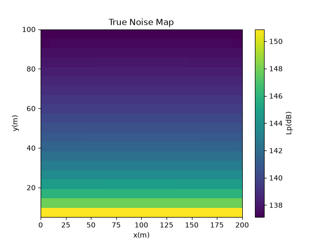
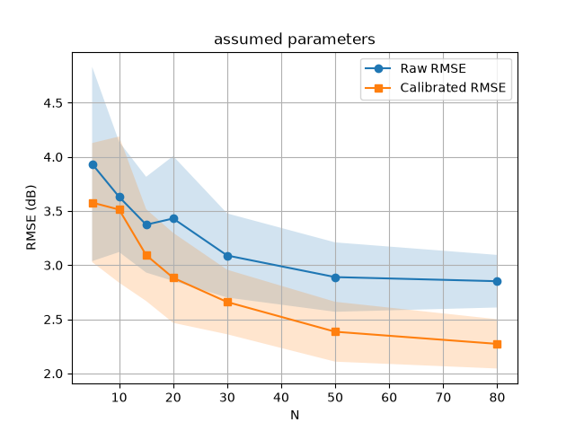

# Nghiên cứu dự án & Tổng quan

**Tên dự án:** Nghiên cứu tác động của độ ồn đến sức khỏe
**Mô tả ngắn gọn:** Dự án này thực hiện nghiên cứu toàn diện về tác động của nhiễm tiếng ồn đến sức khỏe cộng đồng dựa trên dữ liệu tài liệu nghiên cứu khoa học, mô hình hóa phân tán và tính toán độ chính xác của các phương pháp đo lường và bản đồ hóa tiếng ồn. Mục tiêu là cung cấp cái nhìn tổng quan về các phương pháp đánh giá tiếng ồn, khả năng chính xác của cảm biến smartphone và các mô hình prediction (như CNOSSOS-EU) trong môi trường đường phố.

Chu trình nghiên cứu bao gồm:
- Tự động thu thập tài liệu qua APIs Crossref và OpenAlex
- Xét duyệt và lọc bài nghiên cứu có liên quan đến mô hình nguồn tiếng ồn, calibration smartphone, phương pháp bản đồ hóa (kriging, IDW)
- Trích xuất thông số quan trọng từ các bài viết (mục đích, phương pháp, mẫu số, kết quả, hạn chế)
- Xây dựng báo cáo theo chuẩn PRISMA và tài liệu tham chiếu BibTeX/RIS
- Mô phỏng và đánh giá độ chính xác (RMSE) qua việc nội suy địa점

---
## ✨ Tính năng & Mô-đul chính

| Mô-đun | Mô tả | File chính |
|--------|-------|-----------|
| **Tự thu collect tài liệu** | Tìm kiếm tự động qua Crossref & OpenAlex với 6 nhóm truy vấn về tiếng ồn giao thong, calibration smartphone, bản đồ hóa | `de5_do_on/tai_lieu/scripts/search.py` |
| **Sang lọc bài viết** | Phân loại INCLUDE/EXCLUDE dựa trên từ khóa M1 (mô hình nguồn/lan truyền/VN), M2 (calibration smartphone, accuracy), M3 (noi suy, không đảm bảo) | `de5_do_on/tai_lieu/scripts/screen_export.py` |
| **Xây dựng ma trận & tham chiếu** | Tạo matrix.csv, references.bib, references.ris từ các bài INCLUDE với trích xuất mục tiêu, phương pháp, mẫu số, kết quả, hạn chế | `de5_do_on/tai_lieu/scripts/build_outputs.py` |
| **Xác minh DOI/título** | Kiểm tra tính hợp lệ DOI qua Crossref, phát hiện MISMATCH giữa tiêu đề cung cấp và API | `de5_do_on/tai_lieu/scripts/verify.py` |
| **Mô phỏng phân tán** | Mô hình traffic noise với grid simulation, IDW interpolation, tính RMSE so với ground truth | `de5_do_on/pilot/pilot_ondo.py` |
| **Chuỗi hoạt động đầy đủ** | Chạy toàn bộ pipeline: build_outputs → prisma_counts → kiểm tự động | `de5_do_on/tai_lieu/scripts/run_all.py` |

**Kết quả số liệu chính:**
- **137** bài được đánh giá (screening)
- **101** bài loại (EXCLUDE): 84 do thiếu tài chí/đơn vị phát hành, 17 không liên quan M1/M2/M3
- **36** bài được bao gồm (INCLUDE) trong phân tích chính
- **36** mục trong matrix.csv, references.bib, references.ris
## 💻 Công nghệ & Thư viện sử dụng (Tech Stack)

| Ngôn ngữ / Công cụ | Phiên bản / Version | Mục đích |
|--------------------|---------------------|----------|
| **Python** | 3.12.10 | Ngôn ngữ chính cho toàn bộ script xử lý dữ liệu |
| **Requests** | Cốt lõi | Gọi API Crossref (`api.crossref.org`) và OpenAlex (`api.openalex.org`) |
| **Pandas / NumPy** | Cốt lõi | Xử lý dữ liệu CSV, tính toán thống kê (RMSE, các phương pháp nội suy) |
| **Matplotlib** | Cốt lõi | Vẽ biểu đồ RMSE vs N, bản đồ шу noise (truth_map.png) |
| **CSV / Standard Library** | Cốt lõi | Đọc/viết tệp dữ liệu (.csv, .json, .bib, .ris) |
| **BibTeX / RIS** | Tự tạo | Xuất tài liệu tham chiếu cho báo cáo khoa học |
| **LaTeX / MiKTeX** | Khuyến nghị | Biên dịch báo cáo `.tex` (file `de5_do_on/bao_cao/ban_thu_hoach.tex`) |
| **User-Agent** | `de5-literature/0.1 (mailto:)` | Tránh bị giới hạn rate khi gọi Crossref/OpenAlex (cần điền email vào `mailto:`) |
| **Windows Batch** | `run_script.bat` | lệnh chạy script nhanh |
---
## 📊 Kết quả mô phỏng & Đồ thị (Visualizations)

> ### 🌡️ Ground Truth Noise Map (`truth_map.png`)
> Bản đồ nhiệt độ độ ồn mặt bằng (Ground Truth Noise Map) được tạo từ mô hình traffic noise simulation trong `pilot_ondo.py`. Bản đồ này thể hiện sự phân bố mức tiếng ồn (dB) trên bản đồ lưới 200m × 100m với 7 nguồn phát射 (xe car và xe máy) được phân bố đều theo trục x. Các màu warmer (đỏ/cam) đại diện cho mức độ cao hơn, trong cooler (xanh/lam) thể hiện mức thấp hơn. Bản đồ này đóng vai trò là "ground truth" để đánh giá độ chính xác của các phương pháp nội suy (IDW, Kriging) và số lượng điểm đo cần thiết.
> 
> 
> *Hình: Bản đồ шу ground truth - đồ thị nhiệt độ mức tiếng ồn mô phỏng với lưới 200×100 meter, 7 nguồn phát射*

> ### 📈 RMSE vs Number of Sensors (`rmse_vs_N.png`)
> Biểu đồ mối quan hệ giữa sai số trung bình (RMSE) và số lượng điểm đo $N$ (kèm thanh lỗi ±1 standard deviation). Kết quả cho thấy khi tăng số lượng điểm đo từ 5 lên 80, sai số RMSE giảm từ khoảng 3.93 dB xuống còn 2.85 dB cho phương pháp thô, và từ 3.58 dB xuống 2.38 dB cho phương pháp đã chuẩn hóa. Thanh lỗi (±1 std) thể hiện biến đổi dựa trên các lần chạy Monte Carlo với seed cố định. Biểu đồ này giúp xác định số lượng cảm biến tối thiểu cần thiết để đạt độ chính xác mong muốn trong bản đồ hóa tiếng ồn thực tế.
> 
> 
> *Hình: Biểu đồ RMSE theo số lượng cảm biến N - thể hiện cải thiện precision khi tăng N, có error bars ±1 std.dev*

---

**Phụ thuộc Python (dependencies) cần cài:**
- `requests` - để gọi API
- Các thư viện numpy, matplotlib, csv, json, re, unicodedata (cốt lõi Python, không cần cài thêm)

**Email (khắt buộc cho Crossref/OpenAlex):**
- Cần cung cấp email trong User-Agent để tránh bị giới hạn rate limiting
- Sửa file `scripts/search.py`, `scripts/verify.py`: thay `"User-Agent": "de5-literature/0.1 (mailto:)"` thành `"User-Agent": "de5-literature/0.1 (mailto:email_cua_ban)"`
- Cập nhật biến `MAILTO = "email_cua_ban"` trong cùng các file
## 📁 Cấu trúc thư mục (Project Structure)

```
E:\Đề tài 5\
├── 📄 results.csv                # Kết quả RMSE cho các giá trị N đo lường (5, 10, 15, 20, 30, 50, 80)
├── 📄 rmse_vs_N.png              # Biểu đồ RMSE (thô & đã chuẩn hóa) theo số đo N, có lỗi bars (±1 std)
├── 📄 truth_map.png              # Bản đồ шу "ground truth" artificial - đồ thị nhiệt độ mức tiếng ồn
├── 📄 run_script.bat             # Lệnh chạy nhanh cho pipeline chính
├── 📁 de5_do_on/                 # Thư mục chính chứa dữ liệu và script nghiên cứu
│   ├── 📁 cd/                    # Thư mục chuyển đổi/convert (chứa log và file phụ)
│   ├── 📄 log_AI.md              # Log hoạt động của AI trong quá trình nghiên cứu
│   ├── 📁 pilot/                 # Phần mô phỏng traffic noise với giả định parameters
│   │   ├── 📄 README.md          # Hướng dẫn chạy pilot_ondo.py
│   │   ├── 📄 pilot_ondo.py    # Script mô phỏng noise với IDW interpolation
│   │   ├── 📄 results.csv        # Kết quả RMSE cho pilot
│   │   ├── 📄 rmse_vs_N.png      # Biểu đồ RMSE pilot
│   │   └── 📄 truth_map.png      # Bản đồ шу ground truth pilot
│   ├── 📁 tai_lieu/              # Kho tài liệu nghiên cứu - dữ liệu thu thập từ API
│   │   ├── 📄 README.md          # Giới thiệu cấu trúc tai_lieu
│   │   ├── 📁 scripts/           # 5 script Python xử lý dữ liệu
│   │   │   ├── run_all.py        # Orchestrator: build_outputs → build_prisma → checks
│   │   │   ├── search.py         # Tìm kiếm Crossref/OpenAlex, ghi search_log.csv + candidates.csv
│   │   │   ├── screen_export.py  # Sang lọc candidates → screening (INCLUDE/EXCLUDE)
│   │   │   ├── build_outputs.py  # Tạo matrix.csv, references.bib, references.ris từ Included
│   │   │   └── verify.py         # Xác minh DOI/título cho 13 seed papers (seed_list.csv)
│   │   ├── 📁 candidates.csv     # Tất cả ung viên tìm được (36 sau khi khuyến trung DOI/título)
## 🚀 Hướng dẫn cài đặt & Khởi chạy (Getting Started)

### ⚙️ Môi trường cần thiết

- **Hệ điều hành:** Windows 10/11 (đã test) hoặc Linux/macOS
- **Python:** Phiên bản 3.12 trở lên (3.12.10 khuyến nghị)
- **Thư viện Python cài đặt:**
  ```bash
  pip install requests
  ```
  (Các thư viện numpy, matplotlib, csv, json, re, unicodedata đã có sẵn trong Python chuẩn, không cần cài thêm)

- **Dùng cho báo cáo LaTeX (nếu cần biên dịch `ban_thu_hoach.tex`):**
  - **MiKTeX** (cho Windows) hoặc **TeX Live** (cho Linux/macOS)
  - CompilerLaTeX (pdflatex, xelatex) để tạo PDF từ file `.tex`

- **Email (khắt buộc cho Crossref/OpenAlex):**
  - Cần cung cấp email trong User-Agent để tránh bị giới hạn rate limiting
  - Sửa file `scripts/search.py`, `scripts/verify.py`: thay `"User-Agent": "de5-literature/0.1 (mailto:)"` thành `"User-Agent": "de5-literature/0.1 (mailto:email_cua_ban)"`
  - Cập nhật biến `MAILTO = "email_cua_ban"` trong cùng các file

### 🛠️ Các lệnh cài đặt dependencies

Chạy script khởi tạo môi trường (chỉ cần cài `requests`):

```powershell
# Di chuyển vào thư mục dự án
cd E:\Đề tài 5

# Cài thư viện requests (cần cho tất cả script API)
pip install requests
```

### ▶️ Hướng dẫn lệnh khởi chạy

#### 1. Chạy pipeline toàn bộ (khuyến nghị)

```powershell
cd E:\Đề tài 5\de5_do_on\tai_lieu\scripts
python run_all.py
```

Pipeline này sẽ:
- Chạy `build_outputs.py` → tạo `matrix.csv`, `references.bib`, `references.ris`
- Chạy `build_prisma()` → tạo `prisma_counts.json`
- Chạy `run_checks()` → in kết quả kiểm tra tự động (PASS/FAIL)
- In mẫu 3 hàng matrix và thống kê PRISMA

#### 2. Tìm kiếm và thu thập tài liệu

```powershell
cd E:\Đề tài 5\de5_do_on\tai_lieu\scripts
python search.py
```
- Tạo/fill `search_log.csv`, `candidates.csv` (sau khi khuyến trung DOI/título)
- Ghi nhận: có thể mất khoảng 3-5 phút vì sleep 0.3s giữa các truy vấn (6 nhóm × 2 nguồn)

#### 3. Sang lọc bài viết (INCLUDE/EXCLUDE)

```powershell
cd E:\Đề tài 5\de5_do_on\tai_lieu\scripts
python screen_export.py
```
- Đọc `candidates.csv` → tạo `screening.csv`
- Kết quả dự kiến: INCLUDE=36 | EXCLUDE=101 | Tổng=137

#### 4. Xác minh DOI/título cho 13 seed papers

```powershell
cd E:\Đề tài 5\de5_do_on\tai_lieu\scripts
python verify.py
```
- Đọc `seed_list.csv` → cập nhật cột `status_doi`, `tieu_de_api`, `tac_gia_api`,...
- Kết quả gồm: OK (DOI hợp lệ), UNVERIFIED (khong DOI/lay qua tim kiem), MISMATCH (do giong tieu de thap)

#### 5. Chạy mô phỏng traffic noise (Pilot model)

```powershell
cd E:\Đề tài 5\de5_do_on\pilot
python pilot_ondo.py
```
- Tạo ra 3 file kết quả: `results.csv`, `rmse_vs_N.png`, `truth_map.png`
- Sử dụng giả định parameters (mọi giá trị đều là dummy/ASSUMPTION, không phải từ literature thực)
- Dùng để kiểm tra logic IDW interpolation, RMSE calculation

#### 6. Biên dịch báo cáo LaTeX (nếu có)

```powershell
cd E:\Đề tài 5\de5_do_on\bao_cao
pdflatex ban_thu_hoach.tex
# Hoặc với xelatex/lualatex nếu có ký tự Unicode phức tạp
```
│   │   ├── 📁 screening.csv      # Kết quả quyết định include/exclude + lý do + nhóm M1/M2/M3
│   │   ├── 📁 matrix.csv         # Ma trận tóm tóm 36 bài include (mục đích, phương pháp, mẫu...)
│   │   ├── 📁 references.bib     # File BibTeX 36 bài include
│   │   ├── 📁 references.ris     # File RIS 36 bài include
│   │   ├── 📁 prisma_counts.json # Thống kê PRISMA: identified, screened, excluded, included
│   │   ├── 📁 seed_list.csv      # 13 bài gốc (seed papers) có DOI/cần xác minh
│   │   ├── 📁 check_env.py       # Kiểm tra môi trường chạy script
│   │   ├── 📁 matrix_core.csv    # Core matrix data
│   │   ├── 📁 candidates.csv     # Dữ liệu candidates (cùng level với screening)
│   │   ├── 📁 search_log.csv     # Lịch sử truy vấn API (ngày, nguồn, truy vấn, số kết quả)
│   │   ├── 📁 type_cache.json    # Cache kiểu dữ liệu từ Crossref/RIS
│   │   ├── 📁 candidates.csv     # Dữ liệu candidates đã thu thập
│   │   ├── 📁 screening.csv      # Kết quả xét duyệt
│   │   ├── 📁 matrix.csv         # Ma trận kết quả
│   │   ├── 📁 prisma_counts.json # Thống kê luồng PRISMA
│   │   ├── 📁 seed_list.csv      # 13 hat giong goc
│   │   └── 📄 README.md          # Giới thiệu tai_lieu
│   ├── 📁 de5_do_on/bao_cao/    # Báo cáo LaTeX
│   │   └── 📄 ban_thu_hoach.tex  # Bản thể cấu trúc báo cáo
│   └── 📄 log_AI.md              # Nhật ký hoạt động AI
├── 📁 mo_phong/                  # Thư mục tham số thử nghiệm (placeholder/dummy)
│   └── 📄 params.csv             # Các tham số dummy cho code testing only
└── 📁 cd/                        # Thư mục hệ con
```

---
- **7** bản duplicate đã loại trước khi lưu candidates.csv
- **144** tài liệu ban đầu thu từ Crossref (72) + OpenAlex (72)
- **7** bản duplicate đã loại

---
